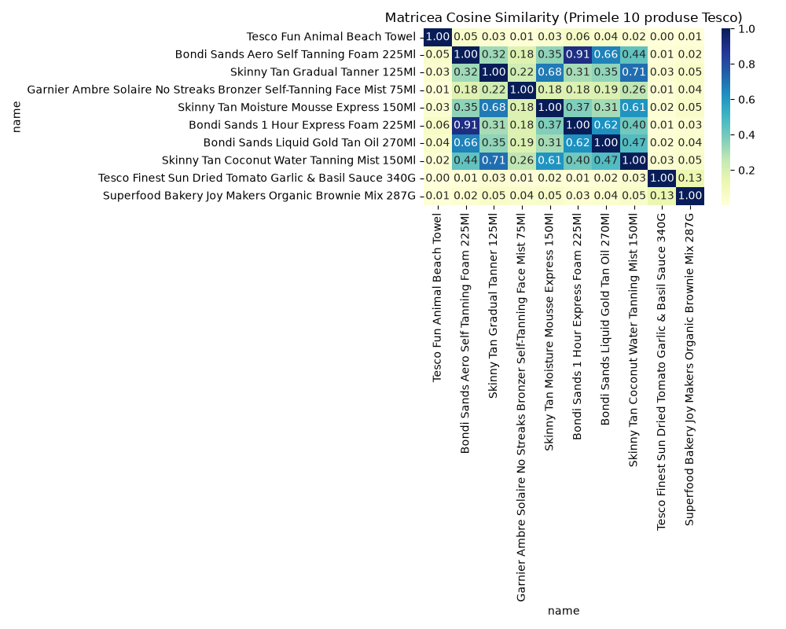

# Laborator 05 — Recomandări Content-Based folosind Cosine Similarity

Implementarea algoritmului de filtrare bazată pe conținut (**Content-Based Filtering**) prin calculul similarității cosinus (**Cosine Similarity**) peste descrierile textuale ale produselor.

---

## 1. Dataset Utilizat
- **Fișier:** `tesco_sample.json`
- **Structură:** Catalog de produse din supermarket-urile Tesco, fiecare intrare având un câmp dedicat `description` ce conține descrierea detaliată a produsului (inclusiv marcaje HTML).
- **Dimensiune vocabular procesat:** 3.691 cuvinte unice.

---

## 2. Pipeline de Preprocesare și Implementare (`cosine_similarity_tesco.py`)

1. **Curățare HTML și filtrare:** S-au eliminat înregistrările fără descriere, iar tag-urile HTML (ex. `<p>`, `<br>`, `<li>`) au fost eliminate folosind expresia regulată `re.sub(r"<[^>]+>", " ", text)`.
2. **Normalizare text:** Descrierile au fost convertite la litere mici (*lowercase*), eliminând cifrele, semnele de punctuație și spațiile multiple.
3. **Vectorizare TF-IDF:** Textele curățate au fost transformate în vectori numerici folosind `TfidfVectorizer(stop_words="english")` din biblioteca `scikit-learn`.
4. **Matricea de similaritate:** S-a calculat similaritatea cosinus între toate perechile de produse cu funcția `cosine_similarity`, salvând și o vizualizare tip heatmap (`cosine_similarity_tesco_heatmap.png`) pentru primele 10 produse.

---

## 3. Rezultate și Perechi Similare Identificate

| Loc | Produs 1 | Produs 2 | Scor Cosine Similarity |
| :---: | :--- | :--- | :---: |
| **1** | **Dragon Universal All Purpose Filler 330G** | **Dragon Universal All Purpose Filler 1.5 Kilograms** | **0.9950** |
| **2** | **Bondi Sands Aero Self Tanning Foam 225Ml** | **Bondi Sands 1 Hour Express Foam 225Ml** | **0.9100** |
| **3** | **Skinny Tan Gradual Tanner 125Ml** | **Skinny Tan Coconut Water Tanning Mist 150Ml** | **0.7100** |

### Justificarea exemplului principal (`0.9950`)
Asocierea dintre **Dragon Universal All Purpose Filler 330G** și **Dragon Universal All Purpose Filler 1.5 Kilograms** are sens pe deplin: cele două intrări reprezintă exact același produs (chit universal pentru reparații interioare), diferența constând exclusiv în gramajul ambalajului (330 g vs. 1,5 kg). Datorită descrierilor aproape identice privind proprietățile și modul de utilizare (*„sands down to a smooth paintable white finish, a handy solution for small home repairs, high adhesion...”*), algoritmul le-a identificat corect ca fiind cele mai asemănătoare produse din setul de date.

---

## 4. Vizualizare Matrice Similaritate (Top 10 Produse)



---

## 5. Instrucțiuni de Rulare

```bash
pip install pandas numpy scikit-learn matplotlib seaborn
python cosine_similarity_tesco.py